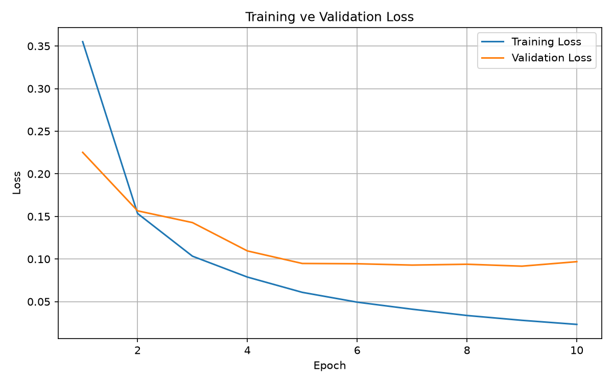
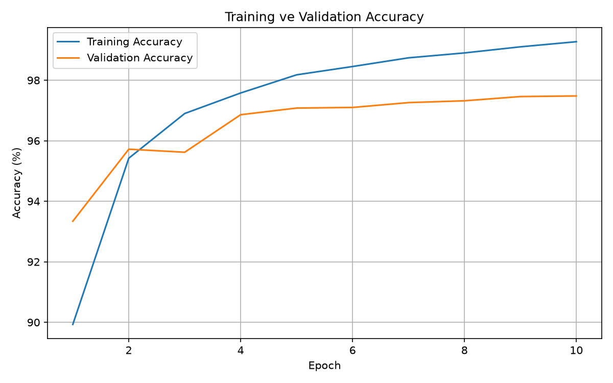
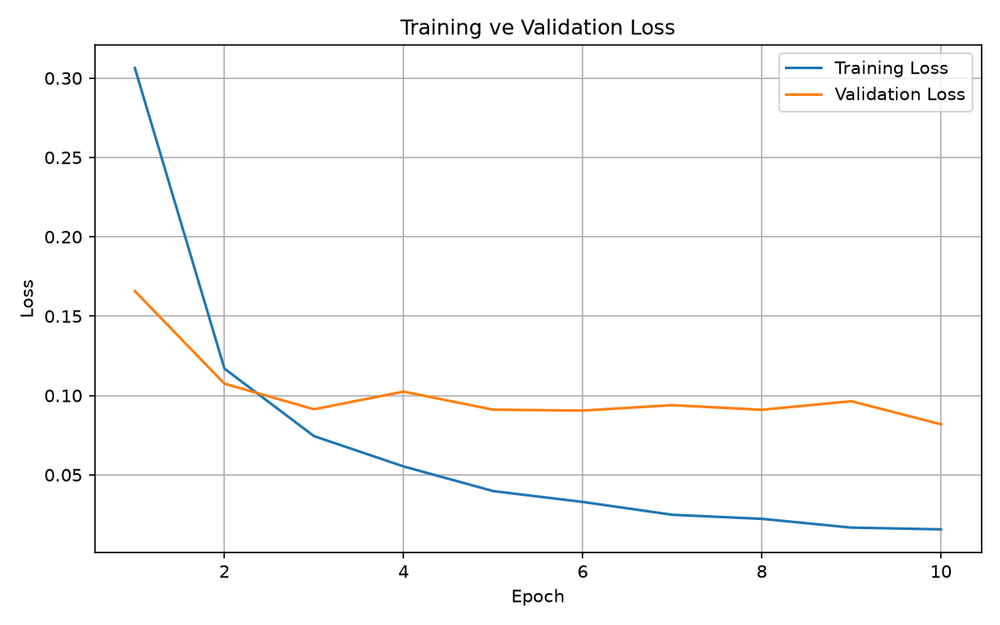
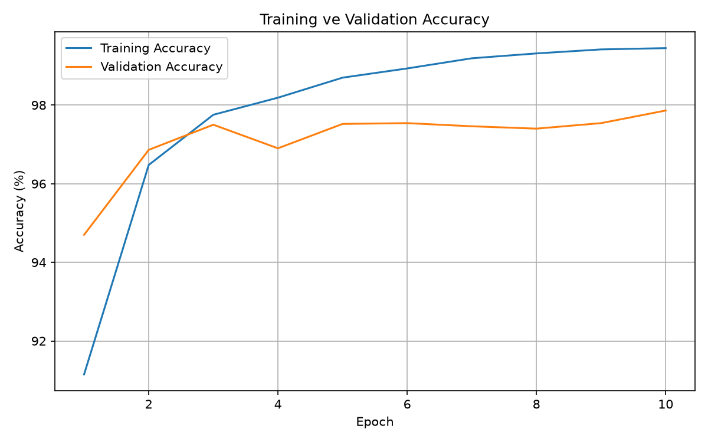

# MNIST Veri Seti ile MLP Tabanlı El Yazısı Rakam Tanıma

## 1. Projenin Amacı

Bu projenin amacı, MNIST veri setini kullanarak Multi-Layer Perceptron (MLP) tabanlı bir yapay sinir ağı geliştirmek, modeli sıfırdan eğitmek ve farklı model yapılandırmalarının performanslarını karşılaştırmaktır.

Ek olarak, kendi el yazımla hazırladığım rakamlar ve öğrenci numaram üzerinde testler gerçekleştirerek modelin eğitim verisi dışındaki görüntülerdeki başarısını değerlendirdim.

Projede CNN kullanılmamıştır.

## 2. Kullanılan Teknolojiler

- Python 3.12
- PyTorch
- Torchvision
- NumPy
- Matplotlib
- Pillow
- SciPy

## 3. Veri Seti ve Veri Ayrımı

Deneylerde 0–9 arasındaki el yazısı rakamlarını içeren MNIST veri seti kullanılmıştır. Görüntüler 28×28 piksel boyutunda ve gri tonlamalıdır.

Her görüntü, MLP modeline verilmeden önce 784 elemanlı bir vektöre dönüştürülür. `ToTensor()` dönüşümü ile piksel değerleri 0–1 aralığına getirilir.

Veri kümeleri şu şekilde ayrılmıştır:

| Veri kümesi | Görüntü sayısı |
|---|---:|
| Eğitim (Train) | 55.000 |
| Doğrulama (Validation) | 5.000 |
| Test (Test) | 10.000 |

Eğitim verileri modelin öğrenmesi, validation verileri model performansının izlenmesi ve en iyi modelin seçilmesi için kullanılmıştır. Test kümesi ise eğitim tamamlandıktan sonra nihai performans değerlendirmesi için kullanılmıştır.

## 4. Model Mimarileri

Her iki deneyde de tam bağlantılı katmanlardan oluşan MLP mimarisi kullanılmıştır. Gizli katmanlarda ReLU aktivasyon fonksiyonu kullanılmıştır. Çıkış katmanında 10 rakama karşılık gelen sınıf skorları üretilmiştir.

### Deney 1 – Temel MLP

- Giriş boyutu: 784
- Birinci gizli katman: 128 nöron
- İkinci gizli katman: 64 nöron
- Çıkış katmanı: 10 nöron
- Toplam parametre sayısı: 109.386

### Deney 2 – Daha Geniş MLP

- Giriş boyutu: 784
- Birinci gizli katman: 256 nöron
- İkinci gizli katman: 128 nöron
- Çıkış katmanı: 10 nöron

İkinci deneyde gizli katmanların nöron sayıları artırılarak model kapasitesindeki değişimin performansa etkisi incelenmiştir.

## 5. Eğitim Hiperparametreleri

| Hiperparametre | Deney 1 | Deney 2 |
|---|---:|---:|
| Epoch sayısı | 10 | 10 |
| Batch size | 64 | 64 |
| Learning rate | 0.001 | 0.001 |
| Optimizer | Adam | Adam |
| Loss fonksiyonu | CrossEntropyLoss | CrossEntropyLoss |
| Aktivasyon | ReLU | ReLU |
| Rastgelelik tohumu | 42 | 42 |

Modeller rastgele başlatılan ağırlıklarla sıfırdan eğitilmiştir; hazır eğitilmiş bir model kullanılmamıştır.

## 6. Deney Sonuçları

| Metrik | Deney 1 | Deney 2 |
|---|---:|---:|
| Son training loss | 0.0233 | 0.0157 |
| Son validation loss | 0.0969 | 0.0819 |
| Training accuracy | %99.27 | %99.45 |
| Validation accuracy | %97.48 | %97.86 |
| Test accuracy | %97.67 | %97.97 |
| Eğitim süresi | 39.94 saniye | 38.61 saniye |

Deney 1'de en iyi validation loss 0.0916, Deney 2'de ise 0.0819 olarak kaydedilmiştir. Yukarıdaki tabloda son epoch sonuçları gösterilmiştir.

## 7. Eğitim Grafikleri

Eğitim sürecinde elde edilen loss ve accuracy grafikleri aşağıda gösterilmiştir.

### Deney 1 – Temel MLP

**Loss grafiği**



**Accuracy grafiği**



### Deney 2 – Daha Geniş MLP

**Loss grafiği**



**Accuracy grafiği**



## 8. Deneylerin Karşılaştırılması

İkinci deneyde gizli katmanlardaki nöron sayıları artırılmıştır. Test doğruluğu %97.67'den %97.97'ye yükselmiştir. Validation doğruluğu da %97.48'den %97.86'ya çıkmıştır.

Bu sonuçlar, bu deneyde daha geniş gizli katmanlara sahip MLP modelinin biraz daha iyi performans gösterdiğini ortaya koymaktadır. Eğitim süreleri birbirine yakın olduğundan ikinci model, benzer bir eğitim süresinde daha yüksek test doğruluğu elde etmiştir.

Her iki modelde de training accuracy değerinin validation accuracy değerinden yüksek olması, modelin eğitim verisinde daha başarılı olduğunu göstermektedir. Bu fark, validation sonuçları ve loss eğrileriyle birlikte değerlendirilmelidir.

## 9. Kendi El Yazısı Rakamları ile Test

### Tek tek rakamların tanınması

Kendi el yazımla hazırladığım 0–9 arasındaki 10 rakam, `predict_handwritten_test.py` dosyası ile test edilmiştir.

Test sonuçları:

- Doğru tahmin: 10/10
- Bu testteki doğruluk: %100

Bu sonuç yalnızca test edilen 10 görüntü için geçerlidir ve genel model başarısının %100 olduğu anlamına gelmez.

### Öğrenci numarasının tanınması

Öğrenci numaramı tek bir kağıda el yazımla yazıp görüntüsünü `all_digits.jpeg` adıyla kaydettim. Bu görüntü, `predict_handwritten.py` dosyası kullanılarak test edilmiştir.

Son testte model, görüntüdeki 11 basamağı ayrı ayrı tahmin ederek öğrenci numaramı doğru şekilde tanımıştır. İlk denemede yanlış tahmin alınmış, görüntü üzerinde yapılan düzenlemeler ve ön işleme adımlarının ardından doğru sonuç elde edilmiştir.

Bu test, görüntü ön işleme adımlarının ve el yazısının özelliklerinin modelin tahminlerini etkileyebildiğini göstermektedir. Ancak test yalnızca kendi el yazımla hazırladığım görüntü üzerinde gerçekleştirildiğinden, elde edilen sonuçlar modelin tüm el yazılarını aynı başarıyla tanıyacağını garanti etmez.

## 10. Genel Değerlendirme

Bu proje kapsamında MNIST veri seti kullanılarak iki farklı MLP modeli oluşturulmuş ve sıfırdan eğitilmiştir. Train, validation ve test ayrımları yapılarak modellerin performansları karşılaştırılmıştır.

İkinci model, test kümesinde %97,97 doğruluk elde ederek ilk modelin %97,67 sonucunu az miktarda aşmıştır. Bu deney, gizli katmanlardaki nöron sayısının artırılmasının model performansına etkisini gözlemlememi sağlamıştır.

Kendi el yazısı rakamları üzerinde yapılan testlerde de başarılı sonuçlar alınmıştır. Bununla birlikte, MNIST görüntüleri ile gerçek el yazısı görüntüleri arasında biçim, hizalama ve kalınlık gibi farklılıklar bulunabilir. Bu durum, eğitim verisi ile gerçek veriler arasındaki dağılım farklılığına (distribution shift) örnektir.

Sonuç olarak, MLP modeli rakam tanıma görevinde başarılı sonuçlar vermiş; model mimarisinin ve görüntü ön işlemenin performans üzerindeki önemi gözlemlenmiştir.

## 11. Kurulum ve Çalıştırma

### Gereksinimler

Python 3.12 ve aşağıdaki kütüphaneler gereklidir:

- PyTorch
- Torchvision
- NumPy
- Matplotlib
- Pillow

### Kurulum

Proje klasöründe sanal ortam oluşturup etkinleştirin:

```bash
python3 -m venv .venv
source .venv/bin/activate
```

Gerekli kütüphaneleri yükleyin:

```bash
pip install -r requirements.txt
```

### Deneyleri çalıştırma

Temel MLP modelini eğitmek için:

```bash
python main.py
```

İkinci deneyi çalıştırmak için:

```bash
python experiment_2.py
```

Kendi el yazısı rakamlarını test etmek için:

```bash
python predict_handwritten_test.py
```

Öğrenci numarası görüntüsünü test etmek için:

```bash
python predict_handwritten.py
```

Eğitim sonuçları, grafikler ve modeller ilgili `results/` ve `models/` klasörlerine kaydedilir.

## 12. Proje Klasör Yapısı

```text
dl_odev/
├── main.py
├── experiment_2.py
├── predict_handwritten.py
├── predict_handwritten_test.py
├── requirements.txt
├── README.md
├── handwritten/
│   ├── images/
│   └── processed/
├── results/
│   ├── loss_curve.png
│   ├── accuracy_curve.png
│   ├── experiment_1.json
│   ├── experiment_2_loss_curve.png
│   ├── experiment_2_accuracy_curve.png
│   └── experiment_2.json
└── models/
    ├── best_mlp.pth
    └── experiment_2_best_mlp.pth
```
